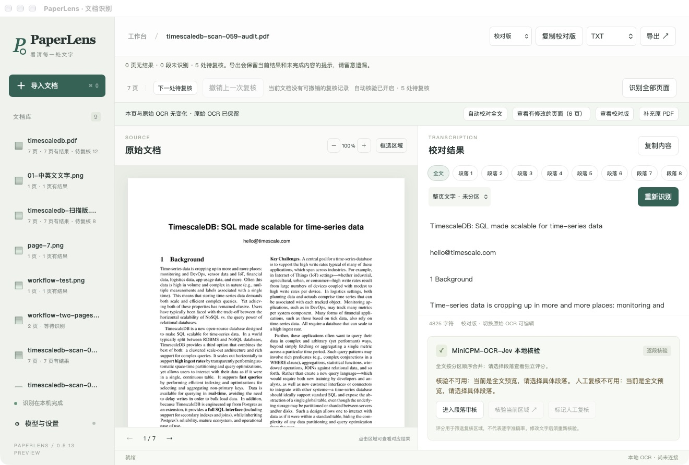
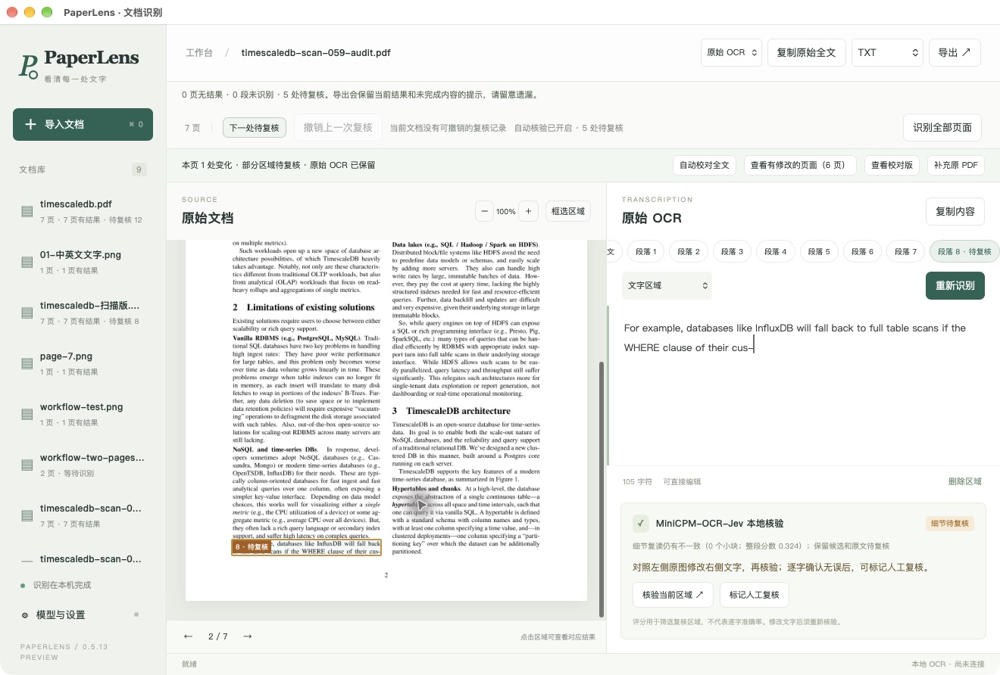
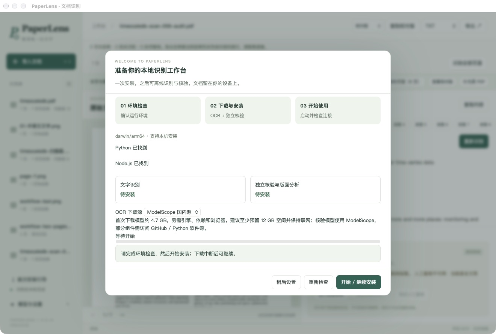

# PaperLens

**Local OCR, automatic proofreading, and paragraph-by-paragraph review.**

PaperLens is a desktop app built with Go and Wails. It uses **MiniCPM-OCR 1.0** to recognize documents and a separate **MiniCPM-OCR-Jev** model to verify the results. Import a PDF or image, compare the source with editable text, review uncertain passages, and export the result.

**Current version:** 0.5.18 preview · **Build targets:** macOS Apple Silicon and Windows x64

The application interface is currently in Chinese. The screenshots below show the actual macOS app using a seven-page scanned document; they are not mockups or a guarantee of recognition accuracy.



*Source pages and recognized text stay side by side. Switch between the original OCR and proofread versions, then copy or export the full document.*

## What you can do

- **Recognize PDFs and images:** import PDF, PNG, JPG, and WebP files, with automatic column and paragraph segmentation.
- **Proofread locally:** re-recognize uncertain regions and check candidate corrections with an independent verifier.
- **Review efficiently:** jump to the next flagged paragraph, edit its text, confirm your review, and undo the last review if needed.
- **Keep your edits:** manual changes take priority and are included in the proofread version and its exports.
- **Export reusable text:** copy the current paragraph or full document, or export TXT, Markdown, and JSON.

## Review uncertain paragraphs



*“Next pending review” opens the corresponding paragraph in editable mode. Compare it with the highlighted source, make any necessary edits, and verify or confirm it. Confirming a review advances to the next issue; the previous review can be undone.*

A pending review means the available evidence is insufficient for automatic confirmation. It does not necessarily mean the text is wrong. The example above intentionally retains an uncertain word split across columns.

## Getting started

1. **Set up the local models.** Follow the first-run setup guide, or open **首次安装引导** (First-time setup) from the sidebar. It checks your environment, installs the models and runtimes, and verifies that the local services work.
2. **Import a document.** Choose a PDF or supported image and run recognition for all pages. PaperLens segments the page and recognizes and verifies individual regions.
3. **Run automatic proofreading.** The app checks for missed regions and attempts a limited number of re-recognition passes on uncertain content. Accepted corrections appear in the proofread version; the original OCR remains available.
4. **Review flagged paragraphs.** Open the next pending review, compare the text with the source, and edit it as needed. Editing invalidates the previous verification score. Confirm a review only after checking the text.
5. **Export the version you want.** Select the original OCR or proofread version and export TXT, Markdown, or JSON. Manual edits are included in the proofread output.

You can import other documents while recognition runs. Resuming unfinished recognition preserves completed paragraphs and manual edits. Re-recognizing a page asks for confirmation before replacing its automatic regions. Export is disabled while a task is running. Closing the app stops model processes that it started.

## First-time model setup



The first-run guide opens automatically when required model files or runtime components are missing. You can also reopen it from the sidebar or model settings.

1. **Start setup.** Click **开始 / 继续安装** (Start / Continue). PaperLens downloads and prepares its own runtime components. You do not need to install Python, Node.js, pip, or configure PATH.
2. **Wait for local components.** PaperLens downloads the OCR model and inference engine, then sets up the separate Jev model, isolated Python environment, Chromium renderer, and layout detector. No terminal commands are needed.
3. **Verify and start.** The guide checks OCR and Jev connectivity and runs a local layout/rendering check before reporting success.

Allow approximately 12 GB of free disk space for model weights (about 4.7 GB), dependencies, and download archives. Initial setup needs an internet connection. The guide shows the current stage and elapsed time; you can leave it running in the background or cancel. Retrying reuses completed downloads and repairs incomplete setup. OCR downloads offer ModelScope and Hugging Face; Jev weights use ModelScope, with runtime dependencies from GitHub, nodejs.org and Python package sources. Go downloads pinned standalone Python and Node archives with SHA256 verification into the application data directory. These private runtimes do not modify your system installations.

After setup, recognition and verification run locally without a cloud API key. Model weights, runtime configuration, and user documents are not included in this repository or application build artifacts. The source installer remains a development utility. Desktop setup always binds verification to the app-managed runtimes, migrating older environments when needed.

## Data and privacy

| Item | Location or behavior |
| --- | --- |
| macOS application data | `~/Library/Application Support/PaperLens` |
| Windows application data | `%APPDATA%/PaperLens` |
| OCR log | `engine.log` in the application data directory |
| Verification log | `local-jev/jev.log` in the application data directory |
| Documents and edits | Local WebView IndexedDB storage |

Model services listen on loopback addresses and use temporary local tokens. The verification renderer blocks external HTTP and HTTPS requests. Initial installation and model downloads require network access.

Export important work regularly. Moving the application bundle to another path can change which WebView storage location it uses.

## How proofreading works

For scans and images, PaperLens detects potentially missed regions, re-recognizes low-confidence passages, and verifies candidate corrections before applying them. For PDFs with a reliable visible text layer, it can create a separate proofread version using that layer and its coordinates. A hidden OCR layer is not automatically treated as trustworthy source text.

The current verification strategy includes:

- **Detailed re-reading:** inspect small text regions, SQL punctuation, and chart labels. Numeric ticks require direct image evidence; missing values are not inferred from a numeric sequence.
- **Context-aware verification:** verify short or ambiguous lines together with their surrounding statement. SQL is rendered literally, with checks that preserve quoted whitespace and comment boundaries.
- **Cross-column and cross-page words:** compare a joined word with the retained hyphenated form using independently recognized source windows. Words without supporting occurrences elsewhere in the document require three windows, with a genuinely expanded third window.
- **Complete text evidence:** clear layout-related false positives only when the existing text agrees with re-reading, every line has passing evidence, and the original dark pixels are accounted for. A separate, continuous, closed SQL frame can be explained as a border; unexplained ink still blocks automatic clearance.

The default review threshold is **0.90**. Word-join candidates must also exceed the retained-hyphen alternative by at least **0.05** in every required window. Partial corrections do not automatically clear a whole paragraph's review status. JSON exports retain evidence and candidate records for inspection.

### Limitations

- Jev scores help prioritize review; they are **not character-level accuracy percentages**. High scores can still accompany missing or incorrect text.
- Automatic segmentation, recognition, and proofreading cannot guarantee completeness or correctness. Check important text against the original.
- Complex charts, rotated labels, multi-column lists, and incomplete words may remain flagged for review.
- Manual confirmation records your review; it is not a model verification result. Changes to either end of a cross-page word join invalidate that join.
- macOS has been tested in the native app. Windows builds are available through CI, but real-device Windows validation is still pending.
- macOS builds are ad-hoc signed and not notarized. Build artifacts do not include release signing or bundled model weights.

## Build and test

Requirements: **Go 1.23+** and **Node.js** for the JavaScript tests. macOS builds require Xcode Command Line Tools. Windows requires WebView2 Runtime to run the app; generating a Windows installer also requires NSIS.

The frontend ships as static assets. JavaScript unit tests do not require installing npm dependencies.

```sh
go test ./...
npm test
```

Build for your target platform:

```sh
sh scripts/build-macos.sh
sh scripts/build-windows.sh
```

The macOS app is written to `build/bin/PaperLens.app`. The Windows executable is written to `build/windows/PaperLens.exe`; the Windows build also creates an installer when NSIS is available.

Browser interaction tests require Playwright and Chrome. For example, with Playwright installed in a separate directory:

```sh
PLAYWRIGHT_MODULE=/absolute/path/to/playwright/index.mjs node tests/workflow-ui.mjs
```

`tests/*-ui.mjs` and `tests/ui.mjs` use an explicitly mocked native bridge to test interactions and recovery from failures. They do not measure model accuracy. Live model tests such as `live_test.go` must be explicitly enabled through environment variables and are skipped by default.

[GitHub Actions](https://github.com/fatelei/paperlens/actions) runs Go race tests, JavaScript and layout tests, and browser interaction tests before building macOS Apple Silicon and Windows x64 artifacts. Runs are triggered by pushes to `main`, pull requests, and manual dispatch. Build artifacts are retained for 14 days. See the [workflow configuration](.github/workflows/ci.yml).

## Project structure

| Path | Purpose |
| --- | --- |
| `app.go`, `engine.go`, `inference.go` | Settings, model lifecycle, and inference |
| `layout.go`, `local_jev/` | Layout detection and independent Jev installation and runtime |
| `frontend/dist/` | Workspace UI, paragraph state, proofreading, and review history |
| `tests/` | Unit tests, interaction tests, and synthetic fixtures |
| `scripts/`, `packaging/` | Platform builds and packaging |
| `docs/images/` | Screenshots of the native application |

## Recent improvements

| Version | Changes |
| --- | --- |
| 0.5.18 | App-managed runtime downloads; no separate Python/Node installation or PATH configuration for desktop users. |
| 0.5.14 | Guided first-run model installation, dependency detection, progress, cancellation/retry, and local service/layout checks. |
| 0.5.13 | Complete line and image evidence can clear layout-related false positives without changing text. Novel word joins require an expanded third verification window. |
| 0.5.12 | SQL statement context, literal-safe verification formatting, and a second window for novel cross-column or cross-page words. |
| 0.5.11 | Cross-column and cross-page word-join evidence, paired updates in the proofread version, and invalidation after manual edits. |
| 0.5.10 | Contextual re-reading, literal SQL rendering, and stronger protections for SQL punctuation and quoted text. |
| 0.5.9 | Fixed scaling and margins for small text, evidence-based line-break repairs, and individual numeric-tick verification. |
| 0.5.8 | Detailed re-reading for code, chart labels, and supported word splits, with candidate audit records. |

## Third-party components

Recognition and verification use the OpenBMB MiniCPM-OCR family. The independent verification SDK is pinned to commit `f5357c72e1605698fa857d74222c0414ca369ae3`; its source copy and license are retained in `local_jev/service/`.

Wails, llama.cpp, PDF.js, fonts, and other bundled components remain subject to their respective upstream licenses. Third-party license files are retained alongside the corresponding components. Downloading and using model weights is subject to their model-card licenses.
